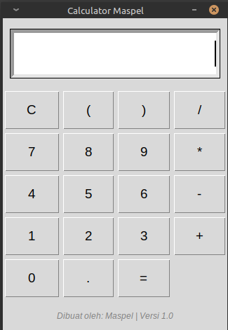

<div align="center">
  <h1>🧮 Calculator Maspel</h1>
  <p>Kalkulator desktop minimalis dan modern yang dibangun dengan Python.</p>

  <!-- Badges (Label kecil yang keren) -->
  
  
  
</div>

---

## 📖 Tentang Proyek Ini

**Calculator Maspel** adalah aplikasi kalkulator desktop sederhana yang dibuat menggunakan bahasa pemrograman **Python** dan *library* antarmuka **Tkinter**. Proyek ini dibuat sebagai sarana belajar membangun aplikasi GUI (Graphical User Interface) yang interaktif dan fungsional.

Aplikasi ini tidak memerlukan *library* eksternal tambahan karena Tkinter sudah menjadi bagian bawaan dari instalasi Python.

## ✨ Fitur Utama

- [x] **Operasi Matematika Dasar**: Penjumlahan (+), Pengurangan (-), Perkalian (*), dan Pembagian (/).
- [x] **Antarmuka Responsif**: Tombol dirancang memenuhi ruang (sticky) agar mudah diklik.
- [x] **Penanganan Error**: Dilengkapi dengan *error handling* untuk mencegah aplikasi *crash* (misalnya saat membagi dengan nol).
- [x] **Desain Minimalis**: Tampilan bersih dengan sentuhan *footer* identitas pembuat.

## 📸 Tampilan Aplikasi

*(Ganti teks di bawah ini dengan screenshot kalkulatormu!)*

<div align="center">
  <!-- Cara menambahkan gambar: Screenshot aplikasimu, simpan di folder proyek dengan nama 'screenshot.png', lalu hapus tanda kurung di bawah -->
  
  <br>
  <i>Tampilan antarmuka Calculator Maspel v1.0</i>
</div>

## 🛠️ Prasyarat (Requirements)

Sebelum menjalankan aplikasi ini, pastikan komputermu sudah memiliki:
1. **Python 3.x** (Sudah diuji pada Python 3.12).
2. **Tkinter** (Biasanya sudah terinstal bawaan di Linux/Windows/Mac).
   - *Jika menggunakan Ubuntu/Debian dan belum ada Tkinter, install dengan perintah:*
     ```bash
     sudo apt install python3-tk